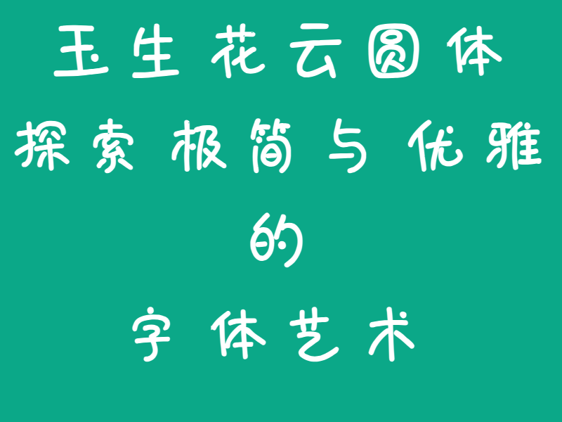

# 玉生花云圆体 (YSHYunYuan)

> **当前版本**: `1.261113` | **作者**: `亦也（郑明海）` | **来自**: `玉生花字库`

## 字体简介

风格定位：温润、亲和、治愈系手写。

这款字体的笔画圆润舒展，带有自然流畅的手写质感，洋溢着温暖而纯粹的治愈气息。

非常适合应用于儿童教育、母婴用品、文创手帐、独立咖啡馆、生活方式杂货、独立书店、香薰疗愈、植物花艺、烘焙甜品等行业。

在产品包装、手帐贴纸、温馨治愈系海报或品牌社交媒体视觉中，它能瞬间拉近与消费者之间的距离，营造出轻松、温馨且毫无距离感的氛围。

---

## 使用须知

本字体目前实现GB2312字符集的3755个中文字符（一级字符），不包含英文字母、数字、标点符号。部分字形跟标准字形不一致。

缺失字符列表请查看 missing_chars.txt。

计划每隔一段时间，更新补全一批字符，直至完成GB2312字符集所有字符。

## 字体授权

所有玉生花字库字体均可免费下载，允许个人非商业免费使用；商业用途请根据实际使用场景购买相应授权。

**允许先商业使用字体，在你的项目上线后，一个月内，补充购买授权。**

详情请查看[字体授权说明文档](licences.md)

## 联系方式

| 项目 | 信息 |
| --- | --- |
| 咨询电话 / 手机（微信同号） | 13146556570 |
| 邮箱 | ysykzheng@qq.com |

联系时，请主动说明来意。滑动页面到最底部，可以扫码添加微信。

## 关于玉生花字库

一直很喜欢艺术，总想在艺术领域做点真正有价值的事。但在刷了无数艺术类内容后，我发现很多赛道早已变了味，充斥着博眼球的套路与浮躁，这让我觉得很不适，也一度很迷茫。

兜兜转转一圈，我把目光投向了字体设计。这是一个极其冷门、甚至有些枯燥的领域——这里没有流量密码，只有成千上万个汉字的枯燥打磨，安静得让人安心。

我本人是技术出身，在做字库的过程中，我尝试引入各种技术手段来辅助设计、提升造字效率。我越来越觉得，现代字体制作，本质上是“理性技术”与“感性艺术”的结合，更是一场需要耐得住性子的工匠修行。

玉生花字库的所有字体，均由主理人：亦也 亲自操刀设计制作。

“玉生花”这三个字，对我有着特殊的意义：它既是我魂牵梦萦的故乡，也是我现在扎根定居的城市。把人生的归处写进品牌的名字里，也是希望我的每一套字，都能像故乡一样真诚，像生活一样耐看。

